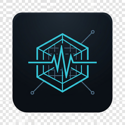

<div align="center">



# MERQO VERTEXA

**Advanced PC &amp; Laptop Diagnostics Software**

*One Software. Complete PC Intelligence. Ultimate Hardware Diagnostics.*

</div>

---

MERQO VERTEXA is a native Windows diagnostics application for technicians, refurbishers, resellers and
power users. It reads what the machine actually reports — WMI/CIM, native IOCTLs, SMBIOS firmware tables,
ATA SMART and NVMe health logs, the registry and performance counters — and turns it into an honest,
attributed hardware report.

It is deliberately boring about one thing: **it never invents a number.** Every metric carries its source,
its detection method and its availability state. When a sensor does not exist, when firmware hides a value
or when Windows denies access, VERTEXA says so instead of showing a plausible-looking guess.

## What it does

| Area | What VERTEXA actually reads |
| --- | --- |
| **System** | Manufacturer, model, SKU, serial (redacted by default), machine type (physical / VM / container) from SMBIOS + WMI |
| **CPU** | Name, vendor, cores, logical processors, base/max clock, cache, virtualization, from `Win32_Processor` |
| **Memory** | Installed vs usable, module-level size/speed/type/manufacturer/part number from SMBIOS type 17 |
| **Graphics** | Each adapter, VRAM, driver version & date, `ConfigManagerErrorCode` interpretation |
| **Storage** | Per-drive media type, capacity, bus, firmware; SMART attributes (ATA) and NVMe health log 0x02; `SmartSource` records which method answered |
| **Battery** | Design capacity vs full-charge capacity, wear, cycle count, charge state, runtime estimate with a confidence label |
| **Display** | Panels, resolutions, refresh rates, HDR capability, plus calibrated full-screen test patterns with operator guidance |
| **Keyboard** | Key-by-key test with an explicit honesty layer: Fn, Ctrl+Alt+Del, media and brightness keys are marked non-deliverable, with the reason |
| **Audio** | Endpoint inventory, generated tones per channel, sweep, microphone capture with objective peak/clipping/noise-floor measurements |
| **Camera** | Device enumeration, driver and problem state (image capture requires your explicit action) |
| **Thermal** | ACPI thermal zones and WMI probes; if nothing is exposed, the report says *Unsupported* — no invented temperatures |
| **Network** | Adapters, link speed, MAC (masked), IPv4/IPv6 presence, Wi-Fi signal where the driver exposes it |
| **Peripherals** | USB/Bluetooth/HID inventory with vendor and problem codes |
| **Drivers** | Third-party driver inventory, versions, dates, signer, problem devices |
| **Benchmarks** | CPU integer throughput, memory bandwidth, storage sequential/random — with a thermal safety governor and a live abort path |

## Health scoring that admits ignorance

The score is a weighted composite of five subsystems (storage 30, battery 20, thermal 20, memory 15,
drivers 15). A subsystem with no evidence is **excluded**, not scored 100. If less than half the weight
is backed by evidence the overall score is reported as **Insufficient evidence**. Benchmarks never raise
a health score. Every subsystem prints its evidence list so a technician can audit the number.

## Reports

PDF, HTML, JSON and CSV, generated entirely in-process by an in-house PDF 1.4 writer (no third-party
reporting dependency). Four report types: Full, Quick, **Buyer Inspection** (strict subset for resale)
and **Technician** (full provenance). Every row states value, source, availability and confidence.
Serial numbers and MAC addresses are masked unless you explicitly turn redaction off. Nothing is uploaded;
there is no network code path in the application.

## Supported platforms

* Windows 11 x64 (build 22000 and later)
* Windows 10 x64, version 1809 (build 17763) and later
* Windows Server 2019/2022 x64 are expected to work but are not part of the test matrix
* No 32-bit, ARM64 or Windows 7/8 support

Read-only operation requires **no administrator rights**. Elevation is only ever requested for specific
measurements (raw ATA SMART via `IOCTL_ATA_PASS_THROUGH`, some firmware tables, TPM details) and the app
explains that in-line. It never modifies your system: no formatting, no driver installs, no BIOS changes,
no security-software tampering.

## Install

Two artifacts are published for each release:

1. `MerqoVertexa-Setup-<version>.exe` — per-user installer, no elevation, installs to
   `%LOCALAPPDATA%\Programs\MERQO VERTEXA`, adds Start Menu and optional desktop shortcuts and a
   standard *Apps & features* uninstall entry. Silent install: `MerqoVertexa-Setup-<version>.exe /S`.
2. `MerqoVertexa-<version>-portable-x64.zip` — extract anywhere and run `MerqoVertexa.exe`.

Both are **unsigned**. SHA-256 checksums are published in `SHA256SUMS.txt` with every release.
See [docs/BUILD_AND_RELEASE.md](docs/BUILD_AND_RELEASE.md) for the honest SmartScreen explanation.

## Build from source

```powershell
dotnet restore MERQO.VERTEXA.sln
dotnet build MERQO.VERTEXA.sln -c Release
dotnet test  tests/MERQO.VERTEXA.UnitTests/MERQO.VERTEXA.UnitTests.csproj -c Release
dotnet publish src/MERQO.VERTEXA.App/MERQO.VERTEXA.App.csproj `
  -c Release -r win-x64 --self-contained true `
  -p:PublishSingleFile=true -p:IncludeNativeLibrariesForSelfExtract=true `
  -o publish/win-x64
```

Requires the .NET 8 SDK on Windows x64. The unit test project targets `net8.0` and therefore also runs on
Linux/macOS; the integration test project targets `net8.0-windows` and exercises real WMI/P-Invoke.

## Documentation

| Document | Purpose |
| --- | --- |
| [PRODUCT_REQUIREMENTS.md](docs/PRODUCT_REQUIREMENTS.md) | Scope, personas, acceptance criteria |
| [SOFTWARE_ARCHITECTURE.md](docs/SOFTWARE_ARCHITECTURE.md) | Assemblies, layering, data flow |
| [TECHNOLOGY_STACK.md](docs/TECHNOLOGY_STACK.md) | Choices and rejections |
| [FEATURE_MATRIX.md](docs/FEATURE_MATRIX.md) | 96-row implementation truth table |
| [HARDWARE_DETECTION_STRATEGY.md](docs/HARDWARE_DETECTION_STRATEGY.md) | Every data source used |
| [DIAGNOSTIC_FALLBACK_STRATEGY.md](docs/DIAGNOSTIC_FALLBACK_STRATEGY.md) | Provider chains and attribution |
| [UI_UX_DESIGN_SYSTEM.md](docs/UI_UX_DESIGN_SYSTEM.md) | Tokens, layout, scaling |
| [SECURITY_AND_PRIVACY.md](docs/SECURITY_AND_PRIVACY.md) | Threat model, data handling |
| [TESTING_STRATEGY.md](docs/TESTING_STRATEGY.md) | What is tested and how |
| [BUILD_AND_RELEASE.md](docs/BUILD_AND_RELEASE.md) | Pipeline, signing posture, SmartScreen |
| [HARDWARE_COMPATIBILITY.md](docs/HARDWARE_COMPATIBILITY.md) | Vendor-specific behaviour |
| [KNOWN_LIMITATIONS.md](docs/KNOWN_LIMITATIONS.md) | What is impossible and why |
| [DEVELOPMENT_ROADMAP.md](docs/DEVELOPMENT_ROADMAP.md) | Phases |
| [PROGRESS.md](docs/PROGRESS.md) | Live state of the build |
| [DECISIONS.md](docs/DECISIONS.md) | ADR log |
| [RELEASE_CHECKLIST.md](docs/RELEASE_CHECKLIST.md) | Gate before tagging |
| [CHANGELOG.md](CHANGELOG.md) · [CONTRIBUTING.md](CONTRIBUTING.md) · [LICENSE](LICENSE) | Process and licence |

## Project status

This repository is the single source of truth. `docs/PROGRESS.md` records what is implemented, what is
verified by CI on Windows and what is still open. Nothing in this README claims a test passed that has not
run in CI — check the Actions tab and the artefacts it produces.

## Contact

MERQO · Founder: **Shohan Khan** · [merqoonline@gmail.com](mailto:merqoonline@gmail.com)

Copyright © 2026 Shohan Khan (MERQO). All rights reserved. See [LICENSE](LICENSE).
